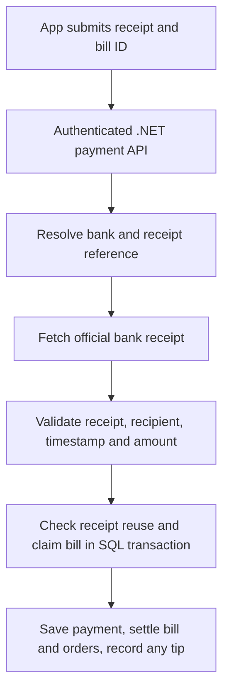

# Implemented backend changes

Restaurant Management System · ASP.NET Core / .NET 9

Updated: 2026-11-24

This document records the implemented receipt-payment changes and related order,
configuration, and startup behavior present in the backend. It describes the
current source under `Api/`; it does not establish production deployment status.
Receipt examples are synthetic. Credentials and customer receipt contents are
excluded.

## 1. Payment architecture

The backend verifies CBE and Telebirr receipts directly against the banks' public
receipt services. The Flutter app sends the scanned QR text or receipt link to
the authenticated .NET API. The server identifies the provider, fetches the bank
record, validates it against the restaurant and bill, then settles the payment.



The previous check.et integration has been replaced:

- `ICheckEtVerifier`, `CheckEtVerifier`, and `CheckEtVerificationResult` were
  removed.
- `PaymentService` now uses `IBankReceiptVerifier` and
  `DirectBankReceiptVerifier`.
- Dependency injection registers a typed `HttpClient` for the direct verifier.
- Payment responses describe verification with the bank instead of check.et.
- New receipt payments have no unverified fallback that can mark a bill paid.
  Missing configuration, unsuccessful verification, or an unreadable receipt
  stops settlement.

The receipt path runs inside the .NET backend. It does not call a Cloudflare
Worker or a hosted Cheki verification API.

## 2. Payment API contract

### Endpoint and authorization

`POST /api/v1/payments/record` records a customer-to-restaurant CBE or Telebirr
transfer. It requires authentication and the `payments.initiate` permission.

Waiter ownership is also checked in the service. A waiter may collect for a
session they opened, a bill they requested, or a session containing their order.
Other authorized roles use the existing permission rules. A table bill can
contain orders from more than one waiter.

### Request

```json
{
  "billId": "11111111-1111-4111-8111-111111111111",
  "qrData": "https://transactioninfo.ethiotelecom.et/receipt/DET0SAMPLE"
}
```

| Field | Current behavior |
|---|---|
| `billId` | Identifies the generated bill to settle; used by the current app flow. |
| `orderId` | Compatibility path: resolves that order's session and an open bill. It does not create a bill. |
| `qrData` | Raw scanner text, up to 4,096 characters. |
| `receiptUrl` | Alternative receipt link, up to 500 characters. |
| `transactionNumber` | Alternative supported reference, up to 120 characters. |
| `method` | Optional `CBE` or `TELEBIRR`; if supplied, it must agree with the receipt. |
| `amountPaid` | Compatibility field; not used as the verified payment amount. Its DTO validation still applies. |
| `payerName` | Compatibility field; not used as the verified payer identity. |

Exactly one of `qrData`, `receiptUrl`, or `transactionNumber` is accepted. The
client does not need a bank selector for recognized receipt links or Telebirr
receipt QR payloads. An opaque current CBE token entered without its URL needs
the compatibility field `method: "CBE"`.

### Response

The endpoint retains the normal API envelope and `PaymentResponse` shape. A
successful new receipt payment reports `status: "PAID"` and
`verificationStatus: "VERIFIED"`.

Illustrative response excerpt:

```json
{
  "success": true,
  "message": "CBE transfer verified with the bank. The receipt is stored on the order.",
  "data": {
    "billId": "11111111-1111-4111-8111-111111111111",
    "method": "CBE",
    "baseAmount": 100.00,
    "tipAmount": 25.00,
    "totalAmount": 125.00,
    "status": "PAID",
    "receiptReference": "FT26SAMPLE01",
    "verificationStatus": "VERIFIED",
    "verifiedAmount": 125.00,
    "verifiedBank": "CBE",
    "verifiedVia": "CBE receipt"
  }
}
```

Input errors use the existing validation response. Ownership failures return
403. Receipt, amount, timing, reuse, or bill-state conflicts return 409. Bank
service failures return 503 with `SERVICE_UNAVAILABLE`. Missing orders or bills
use the existing not-found response.

## 3. Receipt input resolution and QR decoding

`BankReceiptInput` independently identifies the bank on the server. Recognized
inputs include:

| Input | Resolution |
|---|---|
| `https://mbreciept.cbe.com.et/<receipt-token>` | Current CBE JSON receipt lookup. |
| A supported CBE `mb.cbe.com.et` receipt/API link | Resolves the final path token. |
| `https://apps.cbe.com.et:100/?id=<FT-reference><8-digits>` | Legacy CBE PDF lookup. |
| A supported CBE `<FT-reference>-<8-digits>` link | Legacy CBE PDF lookup. |
| A bare supported `FT...` reference | Legacy lookup using the configured receiving account suffix. |
| `https://transactioninfo.ethiotelecom.et/receipt/<reference>` | Telebirr HTML receipt lookup. |
| A supported Telebirr payment receipt QR payload | Decodes the transaction reference, then fetches the bank receipt. |

CBE share tokens retain their case. CBE FT and Telebirr references are normalized
to uppercase. Unrecognized hosts, misleading host suffixes, embedded URL
credentials, unsupported ports, malformed references, and conflicting bank
selections are rejected.

`TelebirrQrDecoder` handles standard and URL-safe Base64, or supported raw hex.
It validates the outer TLV structure and CRC-16, reads the nested transaction
reference field, and applies size and entry limits. A valid CRC establishes QR
integrity; it does not establish payment. Amount and recipient information are
obtained from the bank, not trusted from scanner text.

## 4. Official bank lookups and parsing

| Provider / format | Fixed endpoint | Response |
|---|---|---|
| Current CBE | `https://mb.cbe.com.et/api/v1/transactions/public/transaction-detail/<token>` | JSON |
| Legacy CBE | `https://apps.cbe.com.et:100/?id=<FT-reference><8-digits>` | PDF |
| Telebirr | `https://transactioninfo.ethiotelecom.et/receipt/<reference>` | HTML |

### Current CBE

The verifier sends the CBE web application's app ID/version headers, browser
user agent, origin, referrer, and JSON accept header. App ID/version defaults
can be overridden through configuration.

The parser reads the bank transaction ID, receiver account/name, payer name,
currency, date, amount, and status. It uses `amountCredited`, falling back to
`debitAmount`. It does not use `amountDebited` as the principal fallback or accept
the client's claimed amount when bank amount fields are missing.

The receiver account, transaction reference, and positive payment amount are
required. A supplied nonempty `transactionStatus` or `status` must pass the
completed-payment status rules. Status absence is permitted for CBE; the code
does not invent a completed status when none was returned.

### Legacy CBE

The eight-digit account suffix is a lookup input. The verifier preserves a
suffix supplied in a supported scanned link. It can identify either the payer
or receiver; it is not treated as proof of the restaurant recipient.

A bare FT reference uses the configured CBE receiving account's last eight
digits. A failed lookup prompts for the customer's full receipt link or the
current CBE receipt link.

`PdfPig` extracts text from the downloaded PDF. The parser requires the bank
identity, reference, transferred amount, and payer/receiver account positions.
It uses **Transferred Amount**, excluding a separate total debit that may
include charges. The returned reference must match the requested FT reference.
Recipient matching uses the PDF's receiver account/name.

The legacy PDF does not provide the same explicit status field as the current
JSON response. Verification uses the bank-issued receipt and its extracted
details; it does not manufacture a status value.

### Telebirr

`AngleSharp` reads the official HTML tables. The parser handles supported
English/Amharic labels, inline values, grouped invoice columns, masked receiving
numbers, and amounts such as `10 Birr` or `1,250.00 Birr`.

The invoice number must match the requested reference. The payment amount comes
from **Settled Amount**. A readable receiving identifier and an explicit
completed/success status are required. A receiving bank account/name can also be
extracted for Telebirr-to-bank transfers.

### Common receipt rules

Amounts must be positive ETB, have no more than two decimal places, and not
exceed 99,999,999.99 ETB. References must be nonempty alphanumeric values of at
most 120 characters. Completed-status aliases accepted by the validator are
`COMPLETED`, `SUCCESS`, `SUCCESSFUL`, `SUCCEEDED`, and `PAID`, after normalization.
Supported Amharic success labels are also normalized.

## 5. Restaurant recipient verification

`ReceiptRecipient` compares the bank receiver against existing restaurant
settings:

- CBE: `CbeAccountNumber`.
- Telebirr: `TelebirrNumber`.
- Masked identifiers: also require `AccountHolderName`.

A full unmasked account must equal the configured account after normalization.
That full-number path does not additionally require a holder-name match.

A masked account must expose at least four trailing digits. Its visible prefix
and other visible digits must agree with the configured full account, and the
holder names must match after Unicode normalization, uppercase conversion, and
whitespace normalization. `X`/`x` masks are treated as `*` masks.

Supported Ethiopian phone formats such as `09...`, `9...`, and `2519...` are
normalized, including supported masked forms. A masked value cannot be used as
the configured full receiving account. Name-only matching and short internal
Telebirr codes such as `0003` are rejected.

Telebirr verification first requires the configured Telebirr number. If its
ordinary receiver does not match and a receiving bank account is present, the
code can match that account against the configured CBE number and holder name.

Public masks conceal part of the account. Matching visible digits and a name
does not reconstruct or independently prove the hidden digits; the receiving
configuration must come from the company's actual account information.

## 6. Payment date and time validation

`ReceiptTiming` now validates the bank timestamp before creating a payment or
changing the bill, orders, session, or tip ledger.

Both date and time must actually appear in the receipt. The parser does not
invent today's date for a time-only value or midnight for a date-only value.
Unreadable or missing timestamps stop new settlement.

All comparisons use UTC. Explicit bank timezone offsets are respected.
Supported local Ethiopian timestamps without an offset use UTC+03:00.
Telebirr's day-first date format is handled explicitly.

The accepted window is:

```text
earliest(session.OpenedAt, payable orders' CreatedAt) - 2 minutes
    <= bank payment timestamp
    <= verification time + 2 minutes
```

The two-minute tolerance accommodates clock differences and timestamp
precision. Bill creation time is not the lower bound: payment can happen after
the order starts but before the bill is generated. Crossing midnight is valid
when the timestamp fits this window.

Old unused receipts outside the window and future timestamps beyond the
tolerance return a conflict. Retrying an already settled payment for the same
bill returns its existing record without applying a new age check.

## 7. Amounts, bills, orders, and tips

The bill amount due is:

```text
baseAmount = round(bill.Subtotal + bill.TaxTotal - bill.DiscountAmount, 2)
tipAmount  = bank-confirmed principal - baseAmount
```

The bank principal must cover the whole bill. Underpayment is rejected; a short
receipt does not create a partial settlement. An overpayment is recorded as the
collecting waiter's tip, with the existing fallback to the session owner.
Client `amountPaid` and `payerName` never replace the bank's values.

Successful receipt settlement performs these changes together:

1. Superseded initiated payment sessions are marked retracted.
2. A paid, verified payment is saved with its bank reference and receipt URL.
3. The bill is marked paid and records its tip and paid total.
4. All payable orders on the bill are marked paid.
5. The dining session is marked paid and closed.
6. An occupied restaurant table is released when the session has a table.
7. One waiter-tip entry is created when overpayment is positive.

The payment belongs to the generated bill. Its `OrderId` identifies a
representative order, while the bill's items connect it to every included order.
Cancelled, zero-total kitchen tickets are excluded from settlement.

The current order/billing model supports independent takeaway sessions with no
table. Takeaway packaging fees are snapshotted on the order, added to the bill
subtotal once, and billed without tax. Dine-in creation requires a table number
and uses that table's active session. A repeated bill-generation request returns
the existing open bill. Billing does not add a manually entered tip; receipt
overpayment determines the digital tip at settlement.

## 8. Concurrent settlement and receipt reuse

Bank requests run before the settlement transaction. Once the bank receipt
passes validation, conditional SQL updates claim the existing bill and order
rows until the transaction commits.

`GuardBillAsync` checks the original bill status and financial totals and
verifies that the bill's order membership still matches the orders being paid.
`GuardOrderAsync` checks each order's payment state, total, and update timestamp.
Changed or already-paid records cause a conflict.

These guards are used by receipt settlement, payment initiation including cash,
successful gateway webhooks, and payment transfer. They prevent a bank response
that arrives after a cash settlement from paying the bill again.

Receipt reuse is checked using the bank-returned reference and receipt URL.
The application rejects reuse of paid, refunded, or transferred receipts for a
new payment. The database also retains its existing unique receipt-reference
index for rows with status `Paid` and a non-null reference.

Two concurrent calls using the same receipt for the same bill return one
settlement. Calls competing for the same bill with different receipts, or for
different bills using the same receipt, cannot both create successful
settlements. The conflict handler can return the already-created same-bill
payment after a concurrent retry.

Canonical bank references identify the same legacy CBE receipt even when its
sender and receiver lookup suffixes differ. Historical verified records without
a stored bank reference can still be recognized by their receipt URL; duplicate
coverage for those older records is limited by their stored data.

Transfer retains receipt verification/audit information in the destination
payment while retiring the original payment as transferred. Refund and transfer
authorization remains under the existing payment permissions. Reusing a
refunded receipt does not turn it into a new payment.

## 9. HTTP reliability and outbound limits

| Setting | Current value |
|---|---|
| Current CBE overall deadline | 10 seconds |
| Legacy CBE overall deadline | 30 seconds |
| Telebirr overall deadline | 20 seconds |
| CBE fetch attempts | Up to four |
| Delay between CBE attempts | 500 milliseconds |
| Telebirr fetch attempts | One |
| HTML/JSON response limit | 2 MiB |
| Legacy PDF response limit | 5 MiB |
| PDF page limit | 20 |
| Redirects | Up to three, checked individually |

CBE network errors and HTTP 404, 408, 429, or 5xx responses are retried within
the original provider deadline. A successfully parsed failed payment, recipient
mismatch, timing violation, or insufficient amount is rejected without another
bank fetch.

Automatic redirects are disabled on the injected HTTP handler. The verifier
rebuilds bank URLs and checks the allowed host, scheme, and port at every
redirect. Download limits apply while streaming the response body. Certificate
validation remains enabled. Caller cancellation is honored, including retry
delays.

## 10. Stored records and database impact

The receipt and timing changes reuse the current database schema. No new
migration, receipt table, row-version column, or bank-timestamp column was added.
The deployed database must already contain the repository's existing bill,
session, payment, and tip schema.

New receipt payments use existing fields including `ReceiptReference`,
`ReceiptUrl`, `AmountPaid`, `VerificationStatus`, `VerifiedAmount`,
`VerifiedPayerName`, `VerifiedBank`, `VerifiedAt`, `VerifiedVia`, `VerifiedById`,
`VerificationNote`, and `SettledAt`. The bank timestamp is included in
`VerificationNote`; `VerifiedAt` records the server verification time.

Existing `Unverified`, `Failed`, and `NotRequired` verification enum values
remain available for compatibility and historical records. Their stored
representation was not changed. Existing receipt audit records are not rewritten.

## 11. Related implemented order and startup changes

### Adding items to an existing order

`OrderService.AddOrderItemsAsync` now accepts additions to an already-served
order when the payment/session state still permits changes. It inserts new
`OrderItem` entities explicitly, recalculates order status and totals, and clears
the aggregate order's ready/served timestamps so the new items enter preparation.
Older item preparation and serving history is preserved.

Existing restrictions still reject additions to another waiter's order,
kitchen-cancelled orders, paid or payment-initiated orders, and billed or closed
sessions. New items retain menu price/tax snapshots and preparation-station
routing.

### Owner bootstrap preservation

`DatabaseSeeder` looks up the bootstrap owner by its stable ID before using the
legacy username/phone lookup. Editing the owner's profile no longer causes
startup to insert a second bootstrap account or overwrite the existing name,
username, phone, or credentials. Owner role and active-status initialization
continues.

### Connection configuration

The working-tree `ConnectionStrings:DefaultConnection` configuration was changed
from a local SQL Server target to the configured remote SQL Server. This is a
configuration change, not a schema migration. Connection values and credentials
are not reproduced in this document.

## 12. Dependencies and source files

The API remains on .NET 9. Added parsing dependencies are `AngleSharp 1.10.5`
for HTML and `PdfPig 0.1.16` for PDF extraction. The Telebirr QR decoder is a C#
adaptation of Cheki's MIT-licensed decoder, with attribution in
[THIRD-PARTY-NOTICES.md](../THIRD-PARTY-NOTICES.md).

| File | Responsibility / change |
|---|---|
| [BankReceipt.cs](../Api/Implementation/Dtos/Payment/BankReceipt.cs) | Common bank receipt result. |
| [RecordDigitalPaymentRequest.cs](../Api/Implementation/Dtos/Payment/RecordDigitalPaymentRequest.cs) | Raw QR input, optional provider, compatibility fields. |
| [IBankReceiptVerifier.cs](../Api/Implementation/Interfaces/Payment/IBankReceiptVerifier.cs) | Direct verification contract. |
| [IPaymentService.cs](../Api/Implementation/Interfaces/Payment/IPaymentService.cs) | Updated payment-verification contract description. |
| [BankReceiptInput.cs](../Api/Implementation/Services/Payment/BankReceiptInput.cs) | Provider/input detection and reference validation. |
| [TelebirrQrDecoder.cs](../Api/Implementation/Services/Payment/TelebirrQrDecoder.cs) | Telebirr receipt QR decoding and integrity checks. |
| [DirectBankReceiptVerifier.cs](../Api/Implementation/Services/Payment/DirectBankReceiptVerifier.cs) | Official HTTP lookups, provider deadlines, retries and limits. |
| [BankReceiptParser.cs](../Api/Implementation/Services/Payment/BankReceiptParser.cs) | CBE JSON/PDF and Telebirr HTML parsing. |
| [ReceiptRecipient.cs](../Api/Implementation/Services/Payment/ReceiptRecipient.cs) | Configured restaurant recipient validation. |
| [ReceiptTiming.cs](../Api/Implementation/Services/Payment/ReceiptTiming.cs) | Required timestamp and payment-window validation. |
| [PaymentService.cs](../Api/Implementation/Services/Payment/PaymentService.cs) | Bill validation, reuse checks, guarded settlement and audit records. |
| [PaymentsController.cs](../Api/Api/Controllers/Payment/PaymentsController.cs) | Authenticated receipt endpoint and bank-verification response message. |
| [ServiceCollectionExtensions.cs](../Api/Api/Extensions/ServiceCollectionExtensions.cs) | Typed HTTP client registration and manual redirect handling. |
| [RestaurantManagement.Api.csproj](../Api/Api/RestaurantManagement.Api.csproj) | HTML/PDF package references. |
| [OrderService.cs](../Api/Implementation/Services/Orders/OrderService.cs) | Order additions, ownership and session rules. |
| [BillingService.cs](../Api/Implementation/Services/Billing/BillingService.cs) | Bill/order association, takeaway fee and zero initial tip behavior. |
| [DatabaseSeeder.cs](../Api/Api/Extensions/DatabaseSeeder.cs) | Preserve the existing bootstrap owner profile. |
| [Payment.cs](../Api/Infrustructure/Models/Billing/Payment.cs) | Updated bank-verification audit documentation. |
| [PaymentMethod.cs](../Api/Infrustructure/Enums/Billing/PaymentMethod.cs) | CBE/Telebirr descriptions refer to bank receipts. |
| [PaymentVerificationStatus.cs](../Api/Infrustructure/Enums/Billing/PaymentVerificationStatus.cs) | Bank-verification descriptions; values retained. |
| [RestaurantManagement.sln](../Api/RestaurantManagement.sln) | Includes the backend test project. |

Removed implementation files: `CheckEtVerifier.cs`, `ICheckEtVerifier.cs`, and
`CheckEtVerificationResult.cs`.

## 13. Verification evidence

The last full backend test run recorded during the timestamp implementation
passed **114 tests, with zero failures**. That result predates this documentation
pass and is not a fresh run against any later workspace edits.

Implemented test coverage includes:

- Input recognition, rejected URLs, QR integrity, and reference conflicts.
- CBE principal amounts and legacy PDF extraction.
- Telebirr invoice columns, inline/bilingual labels, integer amounts, and status.
- Four-digit masked recipients, configured names, and phone normalization.
- Legacy sender/receiver suffix handling and missing-lookup errors.
- Bounded retries, failed-payment rejection, and cancellation.
- Missing/incomplete timestamps, UTC conversion, clock-window boundaries and midnight.
- Rejection before bill/order/tip changes for invalid receipt dates.
- Payment before bill generation using the earliest order/session start.
- Underpayment, concurrent settlement, receipt reuse, same-bill retries, cash races,
  signed gateway callbacks, refund reuse prevention, and transfer.
- Order additions and retained ownership/payment/session restrictions.

Tests are in [BankReceiptTests.cs](../Api/Tests/BankReceiptTests.cs),
[ReceiptTimingTests.cs](../Api/Tests/ReceiptTimingTests.cs),
[SettlementTests.cs](../Api/Tests/SettlementTests.cs), and
[OrderAdditionsTests.cs](../Api/Tests/OrderAdditionsTests.cs). Additional refund
regressions present in the workspace are in
[ReceiptRefundTests.cs](../Api/Tests/ReceiptRefundTests.cs); the recorded 114-test
result is not evidence of a separate run of that later file.

Settlement fixtures create and delete uniquely named
`CodexBankReceiptTests_*` SQL Server LocalDB databases. Other applicable fixtures
use isolated EF in-memory databases. Application connection strings and
production restaurant data are not used for these tests.

Read-only checks against user-supplied real receipts confirmed that the current
CBE JSON, legacy CBE PDF, and Telebirr HTML formats can be parsed. Both legacy
CBE lookup suffix variants returned the same transaction after intermittent
lookup failures. These checks did not settle a live restaurant bill or establish
company ownership of the supplied accounts.

## 14. Running requirements and supporting documents

The updated backend requires the .NET 9 runtime, the existing SQL Server schema,
and HTTPS connectivity to the bank hosts above. Direct Telebirr receipt access
depends on the bank service being reachable from the server's network.

Receiving details are read from the existing restaurant settings:
`CbeAccountNumber`, `TelebirrNumber`, and `AccountHolderName`. Optional CBE header
overrides are `BankReceipts:CbeAppId` and `BankReceipts:CbeAppVersion` (environment
form: `BankReceipts__CbeAppId` and `BankReceipts__CbeAppVersion`). The direct
verifier does not use a check.et API key.

Related implementation reference:
[DIRECT_BANK_RECEIPTS.md](DIRECT_BANK_RECEIPTS.md).

